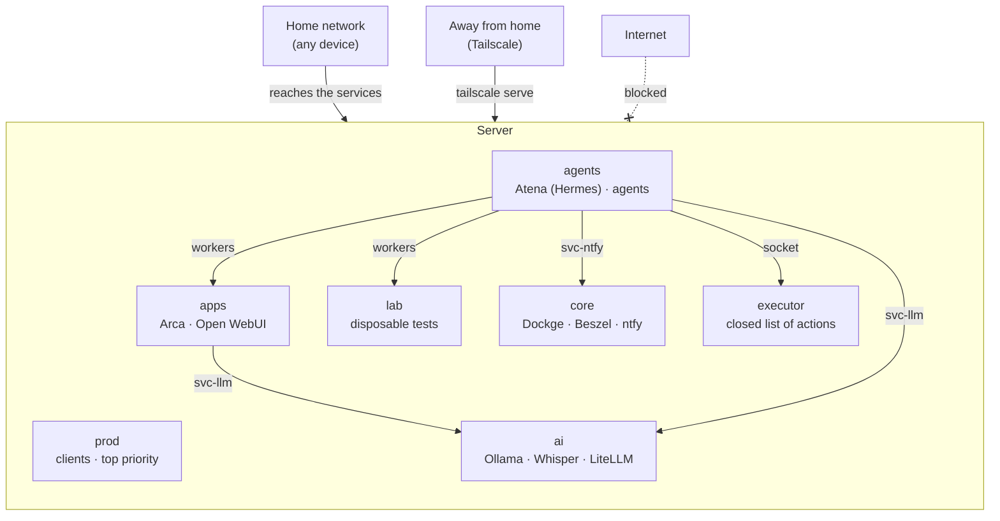

# Atena

**A ready-to-use home server, organized into isolated zones.** Ubuntu + Docker, with a container firewall, CPU and RAM limits per zone, local AI on the GPU, an LLM gateway with spending caps, and a Telegram assistant that looks after all of it.

[Português](README.md)

## What you get

- **Six zones** split by trust level, each with its own network, data folder and CPU/RAM limit.
- **A firewall for containers.** No container can reach your home network or your Tailscale devices. From outside, only your home network reaches the services. ufw alone can't do this, because it doesn't see Docker's ports.
- **Resource limits.** AI agents never slow down client systems: the `prod` zone gets priority and guaranteed memory.
- **Local AI:** Ollama (language models) and Whisper (speech-to-text) on the GPU, including older cards like the GTX 1060.
- **LiteLLM** as a single gateway to Claude (Haiku, Sonnet, Opus) and to the local models, with spending caps per model and per key, reset on the 1st of every month.
- **Dashboards:** Dockge (manage stacks), Beszel (monitoring, GPU included) and Open WebUI (chat in the browser).
- **Atena** (optional): a personal assistant on Telegram, built on [Hermes Agent](https://github.com/NousResearch/hermes-agent). She watches the server, answers questions about it, keeps your notes and acts only through a closed list of actions, asking for your OK before anything destructive. She speaks Brazilian Portuguese.
- **An action executor** with approval on your phone: the only path from agents to the server, no shell, one token per client.
- **Phone notifications** (ntfy): failed services, stopped containers and approval requests with buttons.
- **An installer** that sets everything up on a fresh machine and can be re-run without breaking what's there.

## How the zones fit together



Different zones can't see each other. The links in the diagram are the only ones allowed, and each one is deliberate (see [architecture](docs/en/architecture.md)).

| Zone | Purpose | Limit |
|---|---|---|
| `prod` | Client systems | Top priority, 4 GB of RAM guaranteed |
| `core` | Platform infrastructure | High priority |
| `apps` | Personal apps | Up to 4 GB |
| `ai` | Local AI and LLM gateway | Up to 6 GB |
| `agents` | AI agents | Up to 6 threads and 6 GB, low priority |
| `lab` | Test environments | Up to 6 threads and 4 GB, low priority |

The limits assume 16 GB of RAM. Adjust them in `host/systemd/atena-*.slice`.

## Requirements

- **Ubuntu 26.04** (server, on bare metal) with a **static IP** on your home network.
- An admin user with **sudo** and an **SSH key** set up.
- Optional: an **NVIDIA GPU**. Driver series 580 is the last one that supports Pascal cards (GTX 10xx).
- Optional: a **Tailscale** account to reach the server from outside.

## Installation

```bash
git clone https://github.com/kaincore/atena.git
cd atena
cp atena.conf.example atena.conf
nano atena.conf          # network interface, IP, network range, router, user, GPU
sudo ./install.sh        # --ssh: SSH with keys only · --hermes: installs Atena
```

Then:

1. **Dockge** at `http://<server-ip>:5001` and **Beszel** at `:8090`. **Create the accounts right away**: the first person to open each one becomes the admin.
2. In Beszel, add the system with host `/beszel_socket/beszel.sock`.
3. To use Claude, run `atena-chave-anthropic` and paste your API key (it isn't shown on screen).
4. Start the other stacks from Dockge.
5. Phone notifications: install the ntfy app and create your user with `sudo atena-ntfy-celular <name>`.
6. With `--hermes`: `sudo atena-hermes-chave` (Atena's LiteLLM key, with a cap) and `sudo atena-telegram` (the bot). Details in [operations](docs/en/operations.md#atena-hermes).

## Included services

| Service | Zone | Port | Notes |
|---|---|---|---|
| Dockge 1.5.0 | core | 5001 | Manages the stacks. Has full Docker access: use a strong password |
| Beszel 0.21.0 | core | 8090 | Monitoring. The agent opens no network port |
| Ollama 0.40.5 | ai | server only | Uses CUDA 12 (CUDA 13 doesn't support Pascal GPUs) |
| Whisper (Speaches 0.8.3) | ai | server only | OpenAI-compatible API, int8 on the GPU |
| LiteLLM 1.101.6 | ai | 4000 | Requires a key. Spending caps per model and per key |
| Open WebUI 0.11.4 | apps | 3000 | Talks only to LiteLLM |
| Arca | apps | 3002 | Browser file uploads, no password |
| ntfy 2.28.0 | core | 2586 | Phone notifications and approvals. Login required |
| Hermes Agent 0.22.2 | agents | none | Atena (with `--hermes`). Talks over Telegram |

Versions are pinned on purpose. Before upgrading, read the security advisories and release notes.

## Documentation

The detailed docs are written in Portuguese and English:

- [Architecture](docs/en/architecture.md): zones, networks, limits and communication rules
- [Security](docs/en/security.md): what is protected, how it was tested, and what isn't
- [Operations](docs/en/operations.md): adding stacks, clients and exceptions, and keeping things up to date
- [Lessons learned](docs/en/lessons.md): pitfalls found while building the first server

Commands, file names and on-screen messages are in Portuguese, the project's original language.

## Repository layout

```
install.sh, install/   installer (one step per file)
host/                  system files: Docker, systemd, firewall, SSH, executor, alerts
host/windows/          script and guide for the optional home PC
stacks/<zone>/<name>/  stack compose files
hermes/                Atena: personality, skills, patrol and configuration
tests/                 tests for the executor and the patrol
tools/                 leak checker and commit guard
docs/                  documentation in Portuguese and English
```

## Contributing

Enable the guard that blocks committing secrets:

```bash
git config core.hooksPath tools/hooks
```

## License

[MIT](LICENSE)
