<h1 align="center">
  
</h1>

<p align="center">
  
  
  
  
  
  <a href="https://github.com/kaincore/atena/actions/workflows/verificar.yml"></a>
  <a href="LICENSE"></a>
</p>

<p align="center">
  <b>A ready-to-use home server, organized into isolated zones.</b><br>
  Ubuntu + Docker, with a container firewall, CPU and RAM limits per zone, local AI on the GPU,
  an LLM gateway with spending caps, a Telegram assistant that looks after all of it,
  a lab where Claude Code writes code for you, and a panel on your phone to watch and run the server.
</p>

<p align="center">
  <a href="README.md">Português</a> ·
  <a href="docs/en/architecture.md">Architecture</a> ·
  <a href="docs/en/security.md">Security</a> ·
  <a href="docs/en/operations.md">Operations</a> ·
  <a href="docs/en/lessons.md">Lessons</a>
</p>

```text
atena@server:~$ sudo ./install.sh --hermes --lab --painel
 [ OK ] zones ........ prod · core · apps · ai · agents · lab
 [ OK ] firewall ..... no container can reach your home network
 [ OK ] local ai ..... ollama · whisper · litellm with spending caps
 [ OK ] executor ..... closed list of actions, approval on your phone
 [ OK ] atena ........ online on telegram
 [ OK ] lab .......... claude code builds for you
 [ OK ] panel ........ the server on your phone, tailscale only
atena@server:~$ █
```

## ▌01 // What you get

- **Six zones** split by trust level, each with its own network, data folder and CPU/RAM limit.
- **A firewall for containers.** No container can reach your home network or your Tailscale devices. From outside, only your home network reaches the services. ufw alone can't do this, because it doesn't see Docker's ports.
- **Resource limits.** AI agents never slow down client systems: the `prod` zone gets priority and guaranteed memory.
- **Local AI:** Ollama (language models), Whisper (speech-to-text) and Kokoro (voice replies) on the GPU, including older cards like the GTX 1060.
- **LiteLLM** as a single gateway to Claude (Haiku, Sonnet, Opus) and to the local models, with spending caps per model and per key, reset on the 1st of every month.
- **Dashboards:** Dockge (manage stacks), Beszel (monitoring, GPU included) and Open WebUI (chat in the browser).
- **Atena** (optional): a personal assistant on Telegram, built on [Hermes Agent](https://github.com/NousResearch/hermes-agent). She watches the server (temperature included), answers questions about it, keeps your notes, uses Arca, edits the app stacks with snapshots and undo, and acts only through a closed list of actions, asking for your OK before anything destructive. She speaks Brazilian Portuguese.
- **The lab** (optional): Atena sends programming jobs to Claude Code, which works on its own in a sandbox, asks through your phone when it needs to, and leaves the app ready for her to publish on the home network.
- **The panel** (optional): the server in your browser and on your phone, installable as an app. It shows status, services, sensors, processes, the network, the systemd journal, AI spending and the lab apps; it restarts services and turns the home PC on or off; it sends jobs to Claude Code and publishes, deletes and restores lab apps; it schedules tasks (turn the PC on at 7 pm, restart a service overnight), edits the app stacks and shows the files; it approves or refuses what Atena and Claude Code ask for and shows everything the executor did. Tailscale only, with a password, in a container with no network at all.
- **An action executor** with approval on your phone: the only path from agents to the server, no shell, one token per client.
- **Phone notifications** (ntfy): failed services, stopped containers and approval requests with buttons.
- **An installer** that sets everything up on a fresh machine and can be re-run without breaking what's there.

## ▌02 // Zone map

<p align="center"></p>

<details>
<summary>Text version of the map</summary>

```text
   INTERNET  ×  ── nothing exposed, nothing gets in ──

   HOME NETWORK ──────────┐              ┌────────── TAILSCALE
   any device             │              │        away from home
                          v              v
 ╔═══════════════════════ ATENA SERVER ══════════════════════════╗
 ║                                                               ║
 ║  ┌─ prod ──────────┐  ┌─ core ──────────┐  ┌─ apps ────────┐  ║
 ║  │ clients         │  │ dockge · beszel │  │ arca          │  ║
 ║  │ top priority    │  │ ntfy · panel    │  │ open webui    │  ║
 ║  └─────────────────┘  └──┬─────^────────┘  └───────┬───────┘  ║
 ║ ┌────────────────────────┘     │ svc-ntfy          │ svc-llm  ║
 ║ │┌─ agents ────────────────────┴───┐       ┌───────v───────┐  ║
 ║ ││ atena (hermes) · agents         ├──────>│ ai            │  ║
 ║ │└──┬──────────────────────┬───────┘svc-llm│ ollama        │  ║
 ║ │   │ socket               │ workers       │ whisper       │  ║
 ║ │┌──v──────────────┐  ┌────v────────────┐  │ litellm       │  ║
 ║ └> EXECUTOR · host │  │ lab             │  └───────────────┘  ║
 ║  │ closed list     │  │ claude code     │                     ║
 ║  └─────────────────┘  └─────────────────┘                     ║
 ╚═══════════════════════════════════════════════════════════════╝
```

</details>

Different zones can't see each other. The links in the map are the only ones allowed, and each one is deliberate; agent workers also reach the `apps` zone, and the panel has no network: it talks to the executor through a socket and gets its visits through Tailscale (see [architecture](docs/en/architecture.md)).

| Zone | Purpose | Limit |
|---|---|---|
| `prod` | Client systems | Top priority, 4 GB of RAM guaranteed |
| `core` | Platform infrastructure | High priority |
| `apps` | Personal apps | Up to 4 GB |
| `ai` | Local AI and LLM gateway | Up to 6 GB |
| `agents` | AI agents | Up to 6 threads and 6 GB, low priority |
| `lab` | Claude Code projects and tests | Up to 6 threads and 4 GB (6 GB with the lab), low priority |

The limits assume 16 GB of RAM. Adjust them in `host/systemd/atena-*.slice`.

## ▌03 // Requirements

- **Ubuntu 26.04** (server, on bare metal) with a **static IP** on your home network.
- An admin user with **sudo** and an **SSH key** set up.
- Optional: an **NVIDIA GPU**. Driver series 580 is the last one that supports Pascal cards (GTX 10xx).
- Optional: a **Claude** subscription (Pro or Max), for the lab.
- Optional: a **Tailscale** account to reach the server from outside (required for the panel).

## ▌04 // Installation

```bash
git clone https://github.com/kaincore/atena.git
cd atena
cp atena.conf.example atena.conf
nano atena.conf          # network interface, IP, network range, router, user, GPU
sudo ./install.sh        # --ssh: SSH with keys only · --hermes: Atena · --lab: the lab · --painel: the panel
```

Then:

1. **Dockge** at `http://<server-ip>:5001` and **Beszel** at `:8090`. **Create the accounts right away**: the first person to open each one becomes the admin.
2. In Beszel, add the system with host `/beszel_socket/beszel.sock`.
3. To use Claude, run `atena-chave-anthropic` and paste your API key (it isn't shown on screen).
4. Start the other stacks from Dockge.
5. Phone notifications: install the ntfy app and create your user with `sudo atena-ntfy-celular <name>`.
6. With `--hermes`: `sudo atena-hermes-chave` (Atena's LiteLLM key, with a cap) and `sudo atena-telegram` (the bot). Details in [operations](docs/en/operations.md#atena-hermes).
7. With `--lab`: `sudo atena-claude-conta entrar <account>` for each account in `ATENA_CLAUDE_CONTAS`. Details in [operations](docs/en/operations.md#lab-claude-code).
8. With `--painel`: `sudo atena-painel-senha` and, with Tailscale on, open the address the installer prints (`https://<server>.<tailnet>.ts.net:3100`). On the phone: Chrome's ⋮ menu → Install app. Details in [operations](docs/en/operations.md#panel).

## ▌05 // Included services

| Service | Zone | Port | Notes |
|---|---|---|---|
| Dockge 1.5.0 | core | 5001 | Manages the stacks. Has full Docker access: use a strong password |
| Beszel 0.21.0 | core | 8090 | Monitoring. The agent opens no network port |
| ntfy 2.28.0 | core | 2586 | Phone notifications and approvals. Login required |
| Ollama 0.40.5 | ai | server only | Uses CUDA 12 (CUDA 13 doesn't support Pascal GPUs) |
| Whisper (Speaches 0.8.3) | ai | server only | OpenAI-compatible API, int8 on the GPU |
| Voice (Speaches 0.8.3 + Kokoro) | ai | server only | Atena's voice replies (`ATENA_VOZ=sim`), fp32 on the GPU |
| LiteLLM 1.101.6 | ai | 4000 | Requires a key. Spending caps per model and per key |
| Open WebUI 0.11.4 | apps | 3000 | Talks only to LiteLLM |
| Arca | apps | 3002 | Browser file uploads, no password |
| Hermes Agent 0.22.2 | agents | none | Atena (with `--hermes`). Talks over Telegram |
| Panel 0.6.0 | core | 3100, Tailscale only | The panel (with `--painel`). No network, no root, no npm packages, with a password |
| Claude Code 2.1.302 | lab | apps on 8000-8999 | The lab (with `--lab`). Runs in a sandbox, with no sudo and no Docker; uses your Claude subscription |

Versions are pinned on purpose. Before upgrading, read the security advisories and release notes.

## ▌06 // Documentation

The detailed docs are written in Portuguese and English:

- [Architecture](docs/en/architecture.md): zones, networks, limits, the executor, Atena, the lab and the panel
- [Security](docs/en/security.md): what is protected, how it was tested, and what isn't
- [Operations](docs/en/operations.md): stacks, clients, phone notifications, Atena, the lab, the panel and upgrades
- [Lessons learned](docs/en/lessons.md): pitfalls found while building the first server

Commands, file names and on-screen messages are in Portuguese, the project's original language.

## ▌07 // Repository layout

```text
atena/
├── install.sh, install/   installer (one step per file)
├── host/                  system files: Docker, systemd, firewall, SSH, executor, alerts, lab
│   ├── lab/               the lab's Claude Code bridge, sandbox and scope guard
│   └── windows/           script and guide for the optional home PC
├── stacks/<zone>/<name>/  stack compose files
│   └── core/painel/app/   the panel: server, interface and tests
├── hermes/                Atena: personality, skills, patrol and configuration
├── tests/                 tests for the executor, the patrol and the lab
├── tools/                 leak checker and commit guard
└── docs/                  documentation in Portuguese and English
```

## ▌08 // Contributing

Enable the guard that blocks committing secrets:

```bash
git config core.hooksPath tools/hooks
```

## ▌09 // License

[MIT](LICENSE)

<p align="center"><sub>░▒▓ home-made · isolated zones · nothing exposed ▓▒░</sub><br>
<sub>Banner: the hands from <i>The Creation of Adam</i> (Michelangelo, c. 1512, public domain) in ASCII art.</sub></p>
