<h1 align="center">
  
</h1>

<p align="center">
  
  
  
  <a href="https://github.com/kaincore/atena/actions/workflows/verificar.yml"></a>
  <a href="LICENSE"></a>
</p>

<p align="center">
  <b>Um servidor caseiro pronto para usar, organizado em zonas isoladas.</b><br>
  Ubuntu + Docker, com firewall para containers, limites de CPU e RAM por zona, IA local na GPU,
  um gateway de LLM com tetos de gasto e uma assistente pelo Telegram que cuida de tudo isso.
</p>

<p align="center">
  <a href="README.en.md">English</a> ·
  <a href="docs/pt/arquitetura.md">Arquitetura</a> ·
  <a href="docs/pt/seguranca.md">Segurança</a> ·
  <a href="docs/pt/operacao.md">Operação</a> ·
  <a href="docs/pt/licoes.md">Lições</a>
</p>

```text
atena@servidor:~$ sudo ./install.sh --hermes
 [ OK ] zonas ........ prod · core · apps · ai · agents · lab
 [ OK ] firewall ..... nenhum container alcança a sua rede de casa
 [ OK ] ia local ..... ollama · whisper · litellm com teto de gasto
 [ OK ] executor ..... lista fechada de ações, aprovação no celular
 [ OK ] atena ........ online no telegram
atena@servidor:~$ █
```

## ▌01 // O que vem pronto

- **Seis zonas** separadas por nível de confiança, cada uma com rede, pasta de dados e limite de CPU/RAM próprios.
- **Firewall para containers.** Nenhum container alcança a sua rede de casa nem os seus aparelhos no Tailscale. De fora, só a rede de casa chega aos serviços. O ufw sozinho não faz isso, porque não enxerga as portas do Docker.
- **Limites de recursos.** Os agentes de IA nunca deixam os sistemas de clientes lentos: a zona `prod` tem prioridade e memória garantida.
- **IA local:** Ollama (modelos de linguagem) e Whisper (transcrição de voz) na GPU, inclusive em placas antigas como a GTX 1060.
- **LiteLLM** como porta única para Claude (Haiku, Sonnet, Opus) e para os modelos locais, com teto de gasto por modelo e por chave, renovado todo dia 1º.
- **Painéis:** Dockge (gerenciar as stacks), Beszel (monitoramento, inclusive da GPU) e Open WebUI (chat no navegador).
- **A Atena** (opcional): assistente pessoal pelo Telegram, feita com o [Hermes Agent](https://github.com/NousResearch/hermes-agent). Vigia o servidor, responde sobre ele, guarda as suas notas e age só por uma lista fechada de ações, pedindo o seu ok para o que é destrutivo.
- **Executor de ações** com aprovação no celular: o único caminho dos agentes até o servidor, sem shell, com um token por cliente.
- **Avisos no celular** (ntfy): serviço que falhou, container parado e pedidos de aprovação com botões.
- **Instalador** que monta tudo numa máquina nova e pode rodar de novo sem estragar o que já existe.

## ▌02 // Mapa das zonas

```text
   INTERNET  ×  ── nada exposto, nada entra ──

   REDE DE CASA ──────────┐              ┌────────── TAILSCALE
   qualquer aparelho      │              │        fora de casa
                          v              v
 ╔═══════════════════════ SERVIDOR ATENA ════════════════════════╗
 ║                                                               ║
 ║  ┌─ prod ──────────┐  ┌─ core ──────────┐  ┌─ apps ────────┐  ║
 ║  │ clientes        │  │ dockge · beszel │  │ arca          │  ║
 ║  │ prioridade máx. │  │ ntfy            │  │ open webui    │  ║
 ║  └─────────────────┘  └────────^────────┘  └───────┬───────┘  ║
 ║                                │ svc-ntfy          │ svc-llm  ║
 ║  ┌─ agents ────────────────────┴───┐       ┌───────v───────┐  ║
 ║  │ atena (hermes) · agentes        ├──────>│ ai            │  ║
 ║  └──┬──────────────────────┬───────┘svc-llm│ ollama        │  ║
 ║     │ socket               │ workers       │ whisper       │  ║
 ║  ┌──v──────────────┐  ┌────v────────────┐  │ litellm       │  ║
 ║  │ EXECUTOR · host │  │ lab             │  └───────────────┘  ║
 ║  │ lista fechada   │  │ testes          │                     ║
 ║  └─────────────────┘  └─────────────────┘                     ║
 ╚═══════════════════════════════════════════════════════════════╝
```

Zonas diferentes não se enxergam. As ligações do desenho são as únicas permitidas, e cada uma é feita de propósito; os workers dos agentes também alcançam a zona `apps` (veja [arquitetura](docs/pt/arquitetura.md)).

| Zona | Para quê | Limite |
|---|---|---|
| `prod` | Sistemas de clientes | Prioridade máxima, 4 GB de RAM garantidos |
| `core` | Infra da plataforma | Prioridade alta |
| `apps` | Apps pessoais | Até 4 GB |
| `ai` | IA local e gateway de LLM | Até 6 GB |
| `agents` | Agentes de IA | Até 6 threads e 6 GB, prioridade baixa |
| `lab` | Ambientes de teste | Até 6 threads e 4 GB, prioridade baixa |

Os limites foram pensados para 16 GB de RAM. Ajuste em `host/systemd/atena-*.slice`.

## ▌03 // Requisitos

- **Ubuntu 26.04** (servidor, direto no hardware) com **IP fixo** na rede de casa.
- Um usuário administrador com **sudo** e **chave SSH** configurada.
- Opcional: **GPU NVIDIA**. A série 580 do driver é a última que suporta placas Pascal (GTX 10xx).
- Opcional: conta no **Tailscale** para acessar de fora de casa.

## ▌04 // Instalação

```bash
git clone https://github.com/kaincore/atena.git
cd atena
cp atena.conf.example atena.conf
nano atena.conf          # interface de rede, IP, faixa da rede, roteador, usuário, GPU
sudo ./install.sh        # --ssh: SSH só com chave · --hermes: instala a Atena
```

Depois:

1. **Dockge** em `http://<ip-do-servidor>:5001` e **Beszel** em `:8090`. **Crie as contas logo**: a primeira pessoa que abrir vira administradora.
2. No Beszel, adicione o sistema com o host `/beszel_socket/beszel.sock`.
3. Para usar o Claude, rode `atena-chave-anthropic` e cole a chave da API (ela não aparece na tela).
4. Suba as outras stacks pelo Dockge.
5. Avisos no celular: instale o app ntfy e crie o seu usuário com `sudo atena-ntfy-celular <nome>`.
6. Com `--hermes`: `sudo atena-hermes-chave` (chave da Atena no LiteLLM, com teto) e `sudo atena-telegram` (o bot). Detalhes em [operação](docs/pt/operacao.md#atena-hermes).

## ▌05 // Serviços incluídos

| Serviço | Zona | Porta | Observação |
|---|---|---|---|
| Dockge 1.5.0 | core | 5001 | Gerencia as stacks. Tem acesso total ao Docker: use senha forte |
| Beszel 0.21.0 | core | 8090 | Monitoramento. O agente não abre porta de rede |
| ntfy 2.28.0 | core | 2586 | Avisos e aprovações no celular. Só com usuário |
| Ollama 0.40.5 | ai | só no servidor | Usa o CUDA 12 (o CUDA 13 não suporta GPUs Pascal) |
| Whisper (Speaches 0.8.3) | ai | só no servidor | API compatível com a OpenAI, int8 na GPU |
| LiteLLM 1.101.6 | ai | 4000 | Exige chave. Tetos de gasto por modelo e por chave |
| Open WebUI 0.11.4 | apps | 3000 | Fala só com o LiteLLM |
| Arca | apps | 3002 | Envio de arquivos pelo navegador, sem senha |
| Hermes Agent 0.22.2 | agents | nenhuma | A Atena (com `--hermes`). Conversa pelo Telegram |

As versões são fixas de propósito. Antes de atualizar, leia os avisos de segurança e as notas da versão.

## ▌06 // Documentação

- [Arquitetura](docs/pt/arquitetura.md): zonas, redes, limites, o executor e a Atena
- [Segurança](docs/pt/seguranca.md): o que está protegido, como foi testado e o que não está
- [Operação](docs/pt/operacao.md): stacks, clientes, avisos no celular, a Atena e as atualizações
- [Lições aprendidas](docs/pt/licoes.md): armadilhas encontradas montando o primeiro servidor

## ▌07 // Estrutura do repositório

```text
atena/
├── install.sh, install/   instalador (uma etapa por arquivo)
├── host/                  arquivos do sistema: Docker, systemd, firewall, SSH, executor, avisos
│   └── windows/           script e passo a passo do PC da rede de casa (opcional)
├── stacks/<zona>/<nome>/  composes das stacks
├── hermes/                a Atena: personalidade, habilidades, ronda e configuração
├── tests/                 testes do executor e da ronda
├── tools/                 verificador de vazamentos e trava de commit
└── docs/                  documentação em português e inglês
```

## ▌08 // Contribuindo

Ative a trava que impede commitar segredos:

```bash
git config core.hooksPath tools/hooks
```

## ▌09 // Licença

[MIT](LICENSE)

<p align="center"><sub>░▒▓ feito em casa · zonas isoladas · nada exposto ▓▒░</sub><br>
<sub>Banner: as mãos de <i>A Criação de Adão</i> (Michelangelo, c. 1512, domínio público) em arte ASCII.</sub></p>
