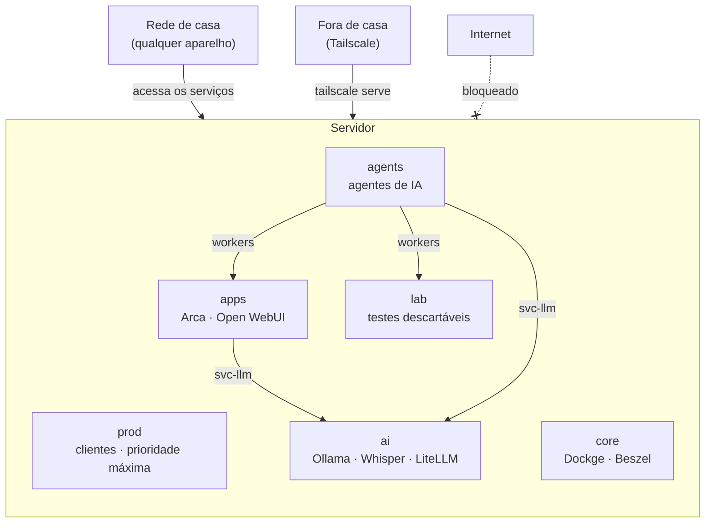

# Atena

**Um servidor caseiro pronto para usar, organizado em zonas isoladas.** Ubuntu + Docker, com firewall para containers, limites de CPU e RAM por zona, IA local na GPU e um gateway de LLM com tetos de gasto.

[English](README.en.md)

## O que vem pronto

- **Seis zonas** separadas por nível de confiança, cada uma com rede, pasta de dados e limite de CPU/RAM próprios.
- **Firewall para containers.** Nenhum container alcança a sua rede de casa nem os seus aparelhos no Tailscale. De fora, só a rede de casa chega aos serviços. O ufw sozinho não faz isso, porque não enxerga as portas do Docker.
- **Limites de recursos.** Os agentes de IA nunca deixam os sistemas de clientes lentos: a zona `prod` tem prioridade e memória garantida.
- **IA local:** Ollama (modelos de linguagem) e Whisper (transcrição de voz) na GPU, inclusive em placas antigas como a GTX 1060.
- **LiteLLM** como porta única para Claude (Haiku, Sonnet, Opus) e para os modelos locais, com teto de gasto por modelo e por chave, renovado todo dia 1º.
- **Painéis:** Dockge (gerenciar as stacks), Beszel (monitoramento, inclusive da GPU) e Open WebUI (chat no navegador).
- **Instalador** que monta tudo numa máquina nova e pode rodar de novo sem estragar o que já existe.

## Como as zonas se encaixam



Zonas diferentes não se enxergam. As ligações do desenho são as únicas permitidas, e cada uma é feita de propósito (veja [arquitetura](docs/pt/arquitetura.md)).

| Zona | Para quê | Limite |
|---|---|---|
| `prod` | Sistemas de clientes | Prioridade máxima, 4 GB de RAM garantidos |
| `core` | Infra da plataforma | Prioridade alta |
| `apps` | Apps pessoais | Até 4 GB |
| `ai` | IA local e gateway de LLM | Até 6 GB |
| `agents` | Agentes de IA | Até 6 threads e 6 GB, prioridade baixa |
| `lab` | Ambientes de teste | Até 6 threads e 4 GB, prioridade baixa |

Os limites foram pensados para 16 GB de RAM. Ajuste em `host/systemd/atena-*.slice`.

## Requisitos

- **Ubuntu 26.04** (servidor, direto no hardware) com **IP fixo** na rede de casa.
- Um usuário administrador com **sudo** e **chave SSH** configurada.
- Opcional: **GPU NVIDIA**. A série 580 do driver é a última que suporta placas Pascal (GTX 10xx).
- Opcional: conta no **Tailscale** para acessar de fora de casa.

## Instalação

```bash
git clone https://github.com/kaincore/atena.git
cd atena
cp atena.conf.example atena.conf
nano atena.conf          # interface de rede, IP, faixa da rede, roteador, usuário, GPU
sudo ./install.sh        # use --ssh para também deixar o SSH só com chave
```

Depois:

1. **Dockge** em `http://<ip-do-servidor>:5001` e **Beszel** em `:8090`. **Crie as contas logo**: a primeira pessoa que abrir vira administradora.
2. No Beszel, adicione o sistema com o host `/beszel_socket/beszel.sock`.
3. Para usar o Claude, rode `atena-chave-anthropic` e cole a chave da API (ela não aparece na tela).
4. Suba as outras stacks pelo Dockge.

## Serviços incluídos

| Serviço | Zona | Porta | Observação |
|---|---|---|---|
| Dockge 1.5.0 | core | 5001 | Gerencia as stacks. Tem acesso total ao Docker: use senha forte |
| Beszel 0.21.0 | core | 8090 | Monitoramento. O agente não abre porta de rede |
| Ollama 0.40.5 | ai | só no servidor | Usa o CUDA 12 (o CUDA 13 não suporta GPUs Pascal) |
| Whisper (Speaches 0.8.3) | ai | só no servidor | API compatível com a OpenAI, int8 na GPU |
| LiteLLM 1.101.6 | ai | 4000 | Exige chave. Tetos de gasto por modelo e por chave |
| Open WebUI 0.11.4 | apps | 3000 | Fala só com o LiteLLM |
| Arca | apps | 3002 | Envio de arquivos pelo navegador, sem senha |

As versões são fixas de propósito. Antes de atualizar, leia os avisos de segurança e as notas da versão.

## Documentação

- [Arquitetura](docs/pt/arquitetura.md): zonas, redes, limites e regras de comunicação
- [Segurança](docs/pt/seguranca.md): o que está protegido, como foi testado e o que não está
- [Operação](docs/pt/operacao.md): adicionar stacks, clientes, exceções e manter tudo atualizado
- [Lições aprendidas](docs/pt/licoes.md): armadilhas encontradas montando o primeiro servidor

## Estrutura do repositório

```
install.sh, install/   instalador (uma etapa por arquivo)
host/                  arquivos do sistema: Docker, systemd, firewall, SSH
stacks/<zona>/<nome>/  composes das stacks
tools/                 verificador de vazamentos e trava de commit
docs/                  documentação em português e inglês
```

## Contribuindo

Ative a trava que impede commitar segredos:

```bash
git config core.hooksPath tools/hooks
```

## Licença

[MIT](LICENSE)
