# Architecture

The server is split into **zones by trust level**. Each zone has four things of its own:

| | Where it lives |
|---|---|
| Configuration (compose files) | `/opt/atena/stacks/<zone>/<stack>/` (system disk) |
| Data | `/srv/<zone>/<stack>/` (can be another disk) |
| Docker network | `zone-<zone>`, with a fixed IP range |
| CPU/RAM limit | systemd's `atena-<zone>.slice` |

## The zones

| Zone | Network | What runs there | Who changes it |
|---|---|---|---|
| `prod` | `zone-prod-<client>` (10.10.101.0/24 onward) | Client systems, one network per client | Admin only |
| `core` | `zone-core` (10.10.0.0/24) | Dockge, Beszel, ntfy, the panel, monitoring and backup | Admin only |
| `apps` | `zone-apps` (10.10.10.0/24) | Personal apps (Arca, Open WebUI) | Admin, and Atena through the executor (with a snapshot before each change) |
| `ai` | `zone-ai` (10.10.20.0/24) | Ollama, Whisper, voice, LiteLLM | Admin |
| `agents` | `zone-agents` (10.10.30.0/24) | Atena (Hermes), AI agents and workers | Admin, and agents through scripts |
| `lab` | `zone-lab` (10.10.40.0/24) | Claude Code projects and apps (lab module) and disposable tests | Admin, Claude Code and Atena (through the executor and her terminal) |

Networks that Compose creates on its own (for example, a stack's internal database network) use `10.20.0.0/16`, away from the home network and from Tailscale (`100.64.0.0/10`).

## Communication between zones

Docker already isolates different networks: a container in `agents` can't reach one in `prod`. The exceptions are deliberate:

- **Service networks (`svc-*`).** They hold only one service and whoever may use it, with no internet access. `svc-llm` (10.10.250.0/24) connects LiteLLM to its consumers. Open WebUI and the agents can use LiteLLM, but can't reach Ollama or anything else in `ai`. `svc-ntfy` (10.10.251.0/24) connects ntfy to whoever publishes notifications (Hermes) without opening the `core` zone.
- **Agent workers.** They join `zone-agents`, `zone-lab` and `zone-apps`, and reach those services by name. The agent orchestrator (Hermes) stays only in `zone-agents`, `svc-llm` and `svc-ntfy`, so nothing under test in `lab` can talk to the thing that runs commands.
- **No agent** joins `zone-core` or `zone-prod-*`.

## Action executor

The executor (`/usr/local/sbin/atena-executor`, with its code in the `atena_executor` package, one module per topic, in `/usr/local/lib/atena-executor`) is the **only path** from clients (Atena and the panel) to the server. It runs on the server itself as the `atena-exec` user and listens on the socket `/run/atena-executor/executor.sock` (group `atena-acoes`).

<p align="center"></p>

<details>
<summary>Text version of the diagram</summary>

```text
You (Telegram) ──> Hermes (agents zone) ──> LiteLLM (svc-llm) ──> Anthropic or home models
                      │
                      └─ socket ──> executor (server) ──> Docker, systemd, files, PC
Phone (ntfy app) <── alerts and approval requests ── executor
      └─ tap Approve ──> ntfy (respostas topic) ──> executor
```

</details>

- **Closed list.** Each action is a function with a fixed command and parameters checked against what exists (stack name, unit, path). There is no shell.
- **One token per client.** The token says which actions and which zones the client may request. Only the hash is stored (`/etc/atena/executor/tokens.json`).
- **Stack zone.** It comes from the compose folder (`/opt/atena/stacks/<zone>/...`) or from the `zone-*` networks. When in doubt, the most restricted one wins.
- **Approval on your phone.** An action that changes something can become a request: the executor sends a notification with Approve and Reject, and only runs after the tap. The request code exists only inside the notification, so the client can't approve itself. Each token says which actions need the phone.
- **Reading without secrets.** The service has a single capability, `CAP_DAC_READ_SEARCH`: it reads any file and only writes to its own folders, Atena's deliveries, Arca and the `apps` zone stacks (the last two through ACLs, without taking ownership of anything). System areas and key, token and password files are refused, and lines with a password, token or key come out as `***`.
- **Audit log.** Every request goes to the journal (`journalctl -u atena-executor`) with client, action, parameters and result.
- **App stacks with snapshots.** `stack.editar` saves the previous content before writing, and `stack.desfazer` brings it back. A compose change only sticks if the whole compose (`docker compose config`, with includes and overrides) fits the zone rules: nothing from the host (`privileged`, `cap_add`, `devices`, host network or PID, the Docker socket), folders only from the stack itself and `/srv/apps/<stack>`, networks only `zone-apps` and `svc-llm`, ports always with an IP in front. `stack.aplicar` checks again and brings the stack up in the background.

| Group | Actions |
|---|---|
| Look at the server | `status.servicos`, `status.recursos`, `status.containers`, `status.sistema`, `gasto.api`, `servico.logs`, `servico.journal`, `sistema.processos`, `sistema.rede`, `sistema.sensores` (temperatures and fans) |
| Files | `arquivo.ler`, `arquivo.buscar`, `arquivo.procurar`, `arquivo.entregar` |
| Private text | `local.processar` (the server's Ollama or the PC's LM Studio, no cloud) |
| Arca | `arca.lista`, `arca.pegar`, `arca.guardar` (by the original name; saving never replaces anything) |
| App stacks | `stack.editar`, `stack.aplicar`, `stack.fotos`, `stack.desfazer` |
| Claude Code (lab module) | `claude.tarefa`, `claude.trabalhos`, `claude.perguntas`, `claude.responder`, `claude.cancelar` |
| Lab apps (lab module) | `app.publicar`, `app.parar`, `app.reiniciar`, `app.cancelar`, `app.apagar`, `app.restaurar`, `app.comando`, `app.lista` |
| Act | `servico.reiniciar` (can require the phone) |
| Home PC (optional) | `pc.estado`, `pc.ligar`, `pc.desligar`, `pc.reiniciar`, `pc.cancelar` |

The server's own alerts also go to your phone: `atena-avisar` reports when an `atena-*` unit fails and, every 5 minutes, when a container stops or becomes unhealthy.

## Atena (Hermes)

Atena is a personal assistant built on [Hermes Agent](https://github.com/NousResearch/hermes-agent). She talks to you on Telegram and looks after the server. Her personality and skills are written in Portuguese.

- **Where she runs.** The `hermes` container in the `agents` zone, as the server's `hermes` user: no Docker, no sudo and no route to your home network. Her data (config, memory, notes) lives in `/srv/agents/hermes`.
- **How she thinks.** Through LiteLLM, with her own key and a monthly cap. Haiku by default; voice messages are transcribed by the home Whisper. With `ATENA_VOZ=sim` (and a GPU), she also answers by voice, generated at home by Kokoro.
- **How she acts.** Only through the executor, with a token that excludes the `prod` zone. Commands inside her own container go through "smart" approval: a helper model allows what is safe and sends anything destructive to you.
- **Personality and rules** in `SOUL.md`: she checks before stating something and asks for your OK before anything destructive.
- **Skills.** `servidor-atena` (how to use the executor) and `notas` (keeping and finding what you send her).
- **Patrol (ronda).** Every 3 minutes a cheap script lists what is out of the ordinary. Hermes compares it with the previous list and only wakes the AI (and spends API credit) when it changes.
- **Private data.** A client document, or anything that can't go to the cloud, goes to `local.processar`: the executor extracts the text and asks a home model, and only the answer goes back to Atena.

## The lab (Claude Code)

Optional (`./install.sh --lab`). Atena sends programming jobs to [Claude Code](https://code.claude.com/), which works on its own, for minutes or hours, in a lab folder, on your Claude subscription (Pro or Max).

```text
You (Telegram) ──> Atena ──> executor ──> queue ──> runner (atena-claude) ──> Claude Code in /srv/lab/projetos/<project>
Claude Code asks for permission or a question ──> bridge (dono.py) ──> queue ──> executor ──> phone (ntfy) and Atena
Finished app ──> app.publicar ──> lab-<project> stack in the lab zone (port 8000-8999 on the home network)
```

- **Who runs it.** The `atena-claude` user, with no sudo and no Docker, started by `atena-claude.path` when a job lands in the queue. Up to 3 jobs at once, one per project, in `atena-lab.slice`. Claude Code is pinned to a version (`ATENA_CLAUDE_VERSAO`) and doesn't update itself.
- **Sandbox.** Claude Code only writes to the project folder. The Docker socket, the executor, D-Bus, systemd and the other zones are hidden, internet is only for package registries, and there's no way out of the sandbox. `git push` and web pages need your phone.
- **The project doesn't get a say.** Claude Code only reads the account settings and `lab.json` (`--setting-sources user`, no hooks), and the runner's git ignores the project's fsmonitor and hooks. A `.git/config` with anything that runs commands makes the job get refused. That's what lets Atena write to projects without opening a path out of the sandbox.
- **Permissions and questions on your phone.** What Claude Code asks for goes to your phone with Approve and Reject (11 min, then denied). A question from it reaches your phone and Atena; with no answer in 10 min, Atena decides; after 30 min, it moves on alone.
- **Accounts.** Those in `ATENA_CLAUDE_CONTAS`, each with its own folder and login (`atena-claude-conta`). When the usage limit is hit, the job stops and Atena tells you; with `ATENA_CLAUDE_TROCA=sim`, it moves on its own to the next logged-in account and continues the same conversation.
- **Apps.** `app.publicar` builds from the project's Dockerfile and runs it in the lab zone: read-only disk (data lives in the `/data` volume), no capabilities, 512 MB, port 8000-8999 on the home network and, with Tailscale, also from outside (Tailscale Serve, only on your tailnet). Deleting the code moves the folder to a trash for 30 days.
- **Skills (optional).** With `ATENA_CLAUDE_SKILLS=sim`, each account gets the frontend-design, mattpocock-skills, pyright-lsp and typescript-lsp plugins and the Impeccable skill (text only, downloaded at a pinned version and checked). Atena picks each job's skill from the lab's catalog (`host/lab/skills.json`), and Claude Code checks its screens with screenshots (`atena-tela`, a headless Chromium that runs inside the sandbox).
- **Atena in the lab.** Projects are mounted in her terminal (write access through an ACL), for small fixes with a commit; big programming goes to Claude Code.
- **Interactive lab.** Your own Claude Code, opened inside `/srv/lab`, gets the same sandbox plus a scope guard that asks before sudo, Docker, paths outside the lab and global installs.

## The panel

Optional (`./install.sh --painel`). The server in your PC and phone browser, installable as an app (PWA): status, services, sensors, processes, network and the systemd journal, the home PC, the lab apps and Claude Code, the schedule, files, AI spending and a history of what you told it to do.

```text
Phone or PC (Tailscale) ──HTTPS :3100──> tailscale serve ──socket──> panel (core zone, no network)
panel ──socket──> executor (own token: 38 actions; only deletes lab apps and only edits app stacks)
```

- **No network.** The container runs with `network_mode: none`: it can't reach the internet, the home network or other containers, and nothing reaches it over the network. Visits arrive through `tailscale serve`, which delivers to the socket `/srv/core/painel/run/painel.sock`, and requests go to the executor through its socket.
- **Tailscale only**, at home too. Tailscale's HTTPS is what makes the app installable and keeps the cookie secure.
- **One account, with a password.** The hash (scrypt) lives in `/srv/core/painel/senha`, written by `atena-painel-senha`. A session lasts 30 days and renews on every use; changing the password signs out every device.
- **Two closed lists.** The panel only asks for its own actions, and its executor token only accepts those, in the core, apps, ai, agents and lab zones: queries, logs, spending, restart a service, turn the PC on and off, the lab apps and Claude Code, the app stacks and reading files. No deleting outside the lab and no editing stacks in other zones.
- **Confirmation on screen.** Restart, shut down, stop, publish and delete ask for confirmation in the panel itself, and deleting an app's data requires typing its name; that's why its token doesn't ask the phone.
- **Approvals center.** What Atena and Claude Code ask for and is waiting for you shows up in the panel with the text that went to the phone: Approve, Refuse or answer the question. It counts the same as the tap on the phone, both keep working, and whoever decides first wins. The panel never decides its own requests; the exception is Claude Code's permissions and questions in jobs the panel started, because Claude Code is the one asking.
- **Activity.** The executor's log (every request from every client, every decision and its events), filtered by client or errors only.
- **Schedule.** The scheduler lives in the panel itself (creating systemd timers would need root): once, every week or every month, running only the actions on the schedulable list (turn the PC on, off or restart it, restart a service, restart, stop or publish a lab app). If the panel is down at the scheduled time, it runs what's late when it comes back, up to the tolerance (15 min by default); past that, the run is marked missed. The phone notice (always, only on failure or never) goes through the executor, because the panel has no network.
- **App stacks and files.** The editor for the apps zone stacks writes through the executor, which keeps a snapshot before every edit and refuses a broken compose; the file arrives with secrets hidden, and the part you change can't contain a hidden secret. The Files tab browses, searches and downloads text from the server, except secrets, like Atena.
- **Pending items.** A list on the home screen with your own items and, when the server has `/opt/atena/README.md`, the ones from its "Pendências conhecidas" section, which are marked done when they leave it.
- **Lab and Claude Code.** The lab apps: publish, restart, stop, cancel what's running, delete (container and image, the code to the trash for 30 days, or the data), restore from the trash and run a command inside the app. Sends jobs to Claude Code (account, model, effort, time, plan only, publish when done) and shows every client's jobs, Atena's included, with the summary; any of them can be cancelled or continued.
- **System.** Temperatures, fans and GPU; the processes using the most CPU or RAM; addresses and open ports, each with its reach (server only, containers, home network, Tailscale or every network); and the systemd journal by unit, severity and time span. Read only, with secrets hidden.
- **A device look.** A desk device in the line of Teenage Engineering and Braun: aluminium or graphite chassis (it follows the device theme), modules with engineering labels, graphite physical keys with yellow only on the primary action, LEDs as the state vocabulary, and a black display with live drawings and 7-segment numerals. The rules live in `stacks/core/painel/DESIGN.md`; the fonts (Archivo and Martian Mono, OFL license) are served by the panel itself.
- **No dependencies.** Node 22, which already runs TypeScript and ships SQLite: not a single npm package. The code lives in the stack (`stacks/core/painel/app`), and the installer updates it on every run.
- **Data.** SQLite database at `/srv/core/painel/painel.db`: sessions (only the token hash), login attempts and a 90-day history of the actions that change something.

## CPU and RAM limits

Each zone is a systemd slice under `atena.slice`. Containers join the slice with `cgroup_parent: atena-<zone>.slice` in the compose file.

| Slice | Rule |
|---|---|
| `atena-prod` | `CPUWeight=1000`, `MemoryLow=4G` (protected memory) |
| `atena-core` | `CPUWeight=500`, `MemoryLow=512M` |
| `atena-apps` | `MemoryMax=4G` |
| `atena-ai` | `MemoryMax=6G` |
| `atena-agents` | `CPUWeight=50`, `CPUQuota=600%`, `MemoryMax=6G` |
| `atena-lab` | `CPUWeight=50`, `CPUQuota=600%`, `MemoryMax=4G` (6G with the lab module: 3 Claude Code jobs plus the apps) |

`atena.slice` has `MemoryLow=5G`, because a slice's memory protection only applies if its parent has protection too.

## Inbound and outbound

- **Containers going out:** the internet and the router's DNS, yes. The home network, Tailscale devices and the server itself, no.
- **Coming in from the home network:** any home device reaches whatever is published on the server's IP.
- **Coming in from away:** only through Tailscale, with `tailscale serve` per service.
- **The panel:** only through Tailscale, at home and away. It has no port on the home network.
- **Internet:** nothing is exposed.

Details and tests in [security](security.md).

## Rules for every stack

1. The compose file lives in `/opt/atena/stacks/<zone>/<stack>/` and data in `/srv/<zone>/<stack>/`. Stack names are unique across all zones.
2. Use the zone's network (`external: true`) and the zone's slice (`cgroup_parent`).
3. Databases go on the stack's own internal network (`internal: true`).
4. Pin the image version (no `:latest`).
5. When publishing a port, always write the IP: `"<server-ip>:<port>:<port>"` for the home network, or `"127.0.0.1:<port>:<port>"` for the server only.

```yaml
services:
  app:
    image: example/app:1.2.3
    cgroup_parent: atena-apps.slice
    volumes:
      - /srv/apps/example/data:/data
    networks: [zone, backend]
    ports:
      - "192.168.0.10:8080:8080"   # home network
      - "127.0.0.1:8080:8080"      # for tailscale serve
    restart: unless-stopped

  db:
    image: postgres:17.11-alpine3.24
    cgroup_parent: atena-apps.slice
    volumes:
      - /srv/apps/example/db:/var/lib/postgresql/data
    networks: [backend]
    restart: unless-stopped

networks:
  zone:
    name: zone-apps
    external: true
  backend:
    internal: true
```

## Dockge and subfolders

Dockge only sees stacks placed directly inside one folder. Since stacks live in `/opt/atena/stacks/<zone>/<stack>`, Dockge reads `/opt/atena/dockge` instead, which holds a symlink to each stack. `atena-stacks-sync.path` creates and removes those links automatically. Create new stacks in the zone's folder, not with Dockge's button.
