# Arquitetura

O servidor é dividido em **zonas por nível de confiança**. Cada zona tem quatro coisas próprias:

| | Onde fica |
|---|---|
| Configuração (composes) | `/opt/atena/stacks/<zona>/<stack>/` (disco do sistema) |
| Dados | `/srv/<zona>/<stack>/` (pode ser outro disco) |
| Rede Docker | `zone-<zona>`, com faixa de IP fixa |
| Limite de CPU/RAM | `atena-<zona>.slice` do systemd |

## As zonas

| Zona | Rede | O que roda | Quem mexe |
|---|---|---|---|
| `prod` | `zone-prod-<cliente>` (10.10.101.0/24 em diante) | Sistemas de clientes, uma rede por cliente | Só o administrador |
| `core` | `zone-core` (10.10.0.0/24) | Dockge, Beszel, ntfy, o painel, monitoramento e backup | Só o administrador |
| `apps` | `zone-apps` (10.10.10.0/24) | Apps pessoais (Arca, Open WebUI) | Administrador e a Atena, pelo executor (com foto antes de cada mudança) |
| `ai` | `zone-ai` (10.10.20.0/24) | Ollama, Whisper, voz, LiteLLM | Administrador |
| `agents` | `zone-agents` (10.10.30.0/24) | A Atena (Hermes), agentes de IA e workers | Administrador e agentes, por scripts |
| `lab` | `zone-lab` (10.10.40.0/24) | Projetos e apps do Claude Code (módulo lab) e testes descartáveis | Administrador, o Claude Code e a Atena (pelo executor e pelo terminal dela) |

As redes que o Compose cria sozinho (por exemplo, a rede interna do banco de uma stack) usam a faixa `10.20.0.0/16`, longe da rede de casa e do Tailscale (`100.64.0.0/10`).

## Comunicação entre zonas

O Docker já isola redes diferentes: um container da zona `agents` não alcança um da zona `prod`. As exceções são feitas de propósito:

- **Redes de serviço (`svc-*`).** Contêm só um serviço e quem pode usá-lo, e não têm saída para a internet. A `svc-llm` (10.10.250.0/24) liga o LiteLLM aos seus consumidores. Assim o Open WebUI e os agentes usam o LiteLLM, mas não alcançam o Ollama nem o resto da zona `ai`. A `svc-ntfy` (10.10.251.0/24) liga o ntfy a quem publica avisos (o Hermes), sem abrir a zona `core`.
- **Workers dos agentes.** Entram em `zone-agents`, `zone-lab` e `zone-apps`, e alcançam esses serviços pelo nome. O orquestrador dos agentes (o Hermes) fica só em `zone-agents`, `svc-llm` e `svc-ntfy`, para que nada de teste no lab consiga falar com quem executa comandos.
- **Nenhum agente** entra em `zone-core` nem em `zone-prod-*`.

## Executor de ações

O executor (`/usr/local/sbin/atena-executor`, com o código no pacote `atena_executor`, um módulo por assunto, em `/usr/local/lib/atena-executor`) é o **único caminho** dos clientes (a Atena e o painel) até o servidor. Ele roda no próprio servidor, como o usuário `atena-exec`, e ouve o socket `/run/atena-executor/executor.sock` (grupo `atena-acoes`).

<p align="center"></p>

<details>
<summary>Diagrama em texto</summary>

```text
Você (Telegram) ──> Hermes (zona agents) ──> LiteLLM (svc-llm) ──> Anthropic ou modelos de casa
                       │
                       └─ socket ──> executor (servidor) ──> Docker, systemd, arquivos, PC
Celular (app ntfy) <── alertas e pedidos de aprovação ── executor
       └─ toque em Aprovar ──> ntfy (tópico respostas) ──> executor
```

</details>

- **Lista fechada.** Cada ação é uma função com comando fixo e parâmetros validados contra o que existe (nome da stack, unidade, caminho). Não há shell.
- **Um token por cliente.** O token diz quais ações e quais zonas o cliente pode pedir. Só o hash fica guardado (`/etc/atena/executor/tokens.json`).
- **Zona da stack.** Vem da pasta do compose (`/opt/atena/stacks/<zona>/...`) ou das redes `zone-*`. Na dúvida, vale a mais restrita.
- **Aprovação no celular.** Uma ação que muda algo pode virar um pedido: o executor manda uma notificação com Aprovar e Recusar, e só roda depois do toque. O código do pedido só existe na notificação, então o cliente não consegue se aprovar. Cada token diz quais ações pedem o celular.
- **Leitura sem segredos.** O serviço tem só a capacidade `CAP_DAC_READ_SEARCH`: lê qualquer arquivo e só escreve nas pastas dele, nas entregas da Atena, no Arca e nas stacks da zona `apps` (estas duas por ACL, sem tirar o dono de nada). Áreas do sistema e arquivos de chave, token e senha são recusados, e linhas com senha, token ou chave saem com `***`.
- **Registro.** Cada pedido vai para o journal (`journalctl -u atena-executor`), com cliente, ação, parâmetros e resultado.
- **Stacks de apps com foto.** `stack.editar` guarda o conteúdo anterior antes de gravar, e `stack.desfazer` volta. Uma mudança no compose só fica se o compose inteiro (`docker compose config`, com includes e overrides) caber nas regras da zona: nada do host (`privileged`, `cap_add`, `devices`, rede ou PID do host, socket do Docker), pastas só da própria stack e de `/srv/apps/<stack>`, redes só `zone-apps` e `svc-llm`, portas sempre com IP na frente. `stack.aplicar` confere de novo e sobe em segundo plano.

| Grupo | Ações |
|---|---|
| Ver o servidor | `status.servicos`, `status.recursos`, `status.containers`, `status.sistema`, `gasto.api`, `servico.logs`, `servico.journal`, `sistema.processos`, `sistema.rede`, `sistema.sensores` (temperaturas e ventoinhas) |
| Arquivos | `arquivo.ler`, `arquivo.buscar`, `arquivo.procurar`, `arquivo.entregar` |
| Texto privado | `local.processar` (Ollama do servidor ou LM Studio do PC, sem nuvem) |
| Arca | `arca.lista`, `arca.pegar`, `arca.guardar` (pelo nome original; guardar não substitui nada) |
| Stacks de apps | `stack.editar`, `stack.aplicar`, `stack.fotos`, `stack.desfazer` |
| Claude Code (módulo lab) | `claude.tarefa`, `claude.trabalhos`, `claude.perguntas`, `claude.responder`, `claude.cancelar` |
| Apps do lab (módulo lab) | `app.publicar`, `app.parar`, `app.reiniciar`, `app.cancelar`, `app.apagar`, `app.restaurar`, `app.comando`, `app.lista` |
| Agir | `servico.reiniciar` (pode pedir o celular) |
| PC da rede de casa (opcional) | `pc.estado`, `pc.ligar`, `pc.desligar`, `pc.reiniciar`, `pc.cancelar` |

Os avisos do próprio servidor também vão ao celular: o `atena-avisar` avisa quando uma unidade `atena-*` falha e, de 5 em 5 minutos, quando um container para ou fica doente.

## A Atena (Hermes)

A Atena é uma assistente pessoal feita com o [Hermes Agent](https://github.com/NousResearch/hermes-agent). Ela conversa com você pelo Telegram e cuida do servidor.

- **Onde roda.** Container `hermes` na zona `agents`, como o usuário `hermes` do servidor: sem Docker, sem sudo e sem rede até a sua casa. Os dados dela (configuração, memória, notas) ficam em `/srv/agents/hermes`.
- **Como pensa.** Pelo LiteLLM, com uma chave própria e teto mensal. Haiku por padrão; mensagens de voz são transcritas pelo Whisper da casa. Com `ATENA_VOZ=sim` (e GPU), ela também responde em voz, gerada em casa pelo Kokoro.
- **Como age.** Só pelo executor, com um token sem a zona `prod`. Comandos no próprio container passam pela aprovação "smart": um modelo auxiliar libera o que é seguro e manda o destrutivo para você decidir.
- **Personalidade e regras** em `SOUL.md`: confere antes de afirmar e pede o seu ok para qualquer medida destrutiva.
- **Habilidades.** `servidor-atena` (como usar o executor) e `notas` (guardar e consultar o que você manda).
- **Ronda.** De 3 em 3 minutos, um script barato lista o que está fora do normal. O Hermes compara com a lista anterior e só acorda a IA (e gasta API) quando ela muda.
- **Dados privados.** Documento de cliente ou dado que não pode ir para a nuvem vai para `local.processar`: o executor extrai o texto e pergunta a um modelo de casa, e só a resposta volta para a Atena.

## O lab (Claude Code)

Opcional (`./install.sh --lab`). A Atena manda trabalhos de programação ao [Claude Code](https://code.claude.com/), que trabalha sozinho, por minutos ou horas, numa pasta do lab, com a sua assinatura do Claude (Pro ou Max).

```text
Você (Telegram) ──> Atena ──> executor ──> fila ──> runner (atena-claude) ──> Claude Code em /srv/lab/projetos/<projeto>
Claude Code pede permissão ou pergunta ──> ponte (dono.py) ──> fila ──> executor ──> celular (ntfy) e Atena
App pronto ──> app.publicar ──> stack lab-<projeto> na zona lab (porta 8000-8999 na rede de casa)
```

- **Quem roda.** O usuário `atena-claude`, sem sudo e sem Docker, disparado pelo `atena-claude.path` quando chega trabalho na fila. Até 3 trabalhos ao mesmo tempo, um por projeto, na `atena-lab.slice`. O Claude Code tem versão fixa (`ATENA_CLAUDE_VERSAO`) e não se atualiza sozinho.
- **Sandbox.** O Claude Code escreve só na pasta do projeto. O socket do Docker, o executor, o D-Bus, o systemd e as outras zonas ficam escondidos, a internet é só para repositórios de pacotes, e não existe sair do sandbox. `git push` e páginas web pedem o celular.
- **A configuração do projeto não manda.** O Claude Code só lê a configuração da conta e o `lab.json` (`--setting-sources user`, sem hooks), e o git do runner ignora o fsmonitor e os hooks do projeto. Um `.git/config` com algo que rode comandos faz o trabalho ser recusado. É isso que permite a Atena escrever nos projetos sem virar um caminho para fora do sandbox.
- **Permissões e perguntas pelo celular.** O que o Claude Code pede vai ao celular com Aprovar e Recusar (11 min, depois nega). Uma dúvida dele chega ao celular e à Atena; sem resposta em 10 min, a Atena decide; em 30 min, ele segue sozinho.
- **Contas.** As de `ATENA_CLAUDE_CONTAS`, cada uma com a própria pasta e o próprio login (`atena-claude-conta`). No limite de uso, o trabalho para e a Atena avisa; com `ATENA_CLAUDE_TROCA=sim`, ele passa sozinho para a próxima conta com login e continua a mesma conversa.
- **Apps.** `app.publicar` constrói pelo Dockerfile do projeto e põe no ar na zona lab: disco só de leitura (os dados ficam no volume `/data`), sem capacidades, 512 MB, porta 8000-8999 na rede de casa e, com Tailscale, também fora de casa (Tailscale Serve, só na sua tailnet). Apagar o código manda a pasta para a lixeira por 30 dias.
- **Skills (opcional).** Com `ATENA_CLAUDE_SKILLS=sim`, cada conta ganha os plugins frontend-design, mattpocock-skills, pyright-lsp e typescript-lsp e a skill Impeccable (só o texto, baixado numa versão fixa e conferido). A Atena escolhe a skill de cada trabalho pelo catálogo do lab (`host/lab/skills.json`), e o Claude Code confere as telas com prints (`atena-tela`, um Chromium sem tela que roda dentro do sandbox).
- **A Atena no lab.** Os projetos estão montados no terminal dela (escrita por ACL), para ajustes pequenos com commit; programação grande vai ao Claude Code.
- **Lab interativo.** O seu Claude Code, aberto dentro de `/srv/lab`, tem o mesmo sandbox e um guarda de escopo que pede confirmação para sudo, Docker, caminhos fora do lab e instalação global.

## O painel

Opcional (`./install.sh --painel`). O servidor no navegador do PC e do celular, instalável como app (PWA): estado, serviços, sensores, processos, rede e registro do systemd, o PC da rede de casa, os apps do lab e o Claude Code, a agenda, os arquivos, o gasto de IA e o histórico do que você mandou fazer.

```text
Celular ou PC (Tailscale) ──HTTPS :3100──> tailscale serve ──socket──> painel (zona core, sem rede)
Celular ou PC (rede de casa, opcional) ──HTTP <IP de casa>:3100──> atena-painel-casa.socket ──socket──> painel
painel ──socket──> executor (token próprio: 38 ações; só apaga apps do lab e só edita stacks de apps)
```

- **Sem rede.** O container tem `network_mode: none`: não alcança a internet, a rede de casa nem outros containers, e nada alcança ele pela rede. As visitas chegam pelo `tailscale serve`, que entrega no socket `/srv/core/painel/run/painel.sock`, e os pedidos vão ao executor pelo socket dele.
- **Pelo Tailscale**, em HTTPS: é o que deixa instalar o app e manter o cookie seguro. Com `ATENA_PAINEL_CASA=sim`, o painel também abre na rede de casa, sem o Tailscale, em `http://<ATENA_LAN_IP>:3100`: o systemd escuta só no IP de casa e entrega cada visita a um segundo socket do painel (`painel-casa.sock`), por onde o cookie sai sem `Secure`. Lá a senha passa aberta no Wi-Fi e o app não instala; desligado (o padrão), nada responde na rede de casa.
- **Uma conta, com senha.** O hash (scrypt) fica em `/srv/core/painel/senha`, gravado pelo `atena-painel-senha`. A sessão dura 30 dias e renova a cada uso; trocar a senha desconecta todos os aparelhos.
- **Duas listas fechadas.** O painel só pede as ações dele, e o token dele no executor só aceita essas, nas zonas core, apps, ai, agents e lab: consultas, logs, gasto, reiniciar serviço, ligar e desligar o PC, os apps do lab e o Claude Code, as stacks de apps e a leitura de arquivos. Nada de apagar fora do lab nem editar stacks de outras zonas.
- **Confirmação na tela.** Reiniciar, desligar, parar, publicar e apagar pedem confirmação no próprio painel, e apagar os dados de um app exige digitar o nome dele; por isso o token não pede o celular.
- **Central de aprovações.** O que a Atena e o Claude Code pedem e espera por você aparece no painel com o texto que foi ao celular: Aprovar, Recusar ou responder a pergunta. Vale o mesmo que o toque no celular, os dois continuam funcionando, e quem decidir primeiro decide. O painel nunca decide um pedido dele mesmo; a exceção são as permissões e as perguntas do Claude Code nos trabalhos que ele mandou, porque quem pede é o Claude Code.
- **Atividade.** O registro do executor (cada pedido de cada cliente, cada decisão e os eventos), com filtro por cliente e só os erros.
- **Agenda.** O agendador fica no próprio painel (criar timers do systemd exigiria root): uma vez, toda semana ou todo mês, rodando só as ações da lista de agendáveis (ligar, desligar e reiniciar o PC, reiniciar um serviço, reiniciar, parar e publicar um app do lab). Com o painel fora do ar na hora marcada, ao voltar ele roda o que atrasou até a tolerância (15 min por padrão); passou disso, a vez fica perdida. O aviso no celular (sempre, só se falhar ou nunca) sai pelo executor, porque o painel não tem rede.
- **Stacks de apps e arquivos.** O editor das stacks da zona apps grava pelo executor, que guarda uma foto antes de cada edição e recusa um compose com erro; o arquivo chega com os segredos ocultos, e o trecho que você muda não pode ter um segredo oculto. A aba Arquivos navega, procura e baixa texto do servidor, menos os segredos, como a Atena.
- **Pendências.** Uma lista no Início com as suas pendências e, quando o servidor tem `/opt/atena/README.md`, as da seção "Pendências conhecidas", que ficam resolvidas quando saem de lá.
- **Lab e Claude Code.** Os apps do lab: publicar, reiniciar, parar, cancelar o que está em andamento, apagar (container e imagem, o código para a lixeira por 30 dias, ou os dados), restaurar da lixeira e rodar um comando dentro do app. Manda trabalhos ao Claude Code (conta, modelo, esforço, tempo, só planejar, publicar quando terminar) e mostra os trabalhos de todos os clientes, inclusive os da Atena, com o resumo; dá para cancelar ou continuar qualquer um.
- **Sistema.** Temperaturas, ventoinhas e GPU; os processos que mais usam CPU ou RAM; os endereços e as portas abertas, cada uma com o alcance (só o servidor, containers, rede de casa, Tailscale ou todas as redes); e o registro do systemd por unidade, gravidade e período. Só leitura, com os segredos ocultos.
- **Visual da policromia contida.** Um templo grego visto de perto, em mármore e tinta: o mármore de dia e uma noite azul-escura quase preta (segue o tema do aparelho), o azul egípcio como único acento, e os outros pigmentos antigos (malaquita, ocre e cinábrio) só como pontos de estado. O meandro é o ornamento e também a medida (os medalhões e as barras se pintam até o valor), o Início é uma lâmina só, composta como uma prancha científica, sem cartões (no alto, a frase do dia escrita a partir dos dados, que só diz "Tudo em ordem" quando conseguiu ler tudo, e a rubrica com o que pede você; no meio, um instrumento gravado com um anel por leitura, com as letras gregas explicadas dos lados e os números contando junto com a tinta, da última leitura vista, e a escada das zonas; nas margens, as notas; embaixo, o colofão com a hora da leitura; rolando, uma régua presa no alto guarda os pedidos, as zonas e as leituras fora do limite), as zonas são a crepidoma do templo (uma escada de mármore em 3D, um degrau por zona), e a entrada são as mãos da Criação de Adão de Michelangelo (de uma foto do afresco, em domínio público), em azul egípcio de dia e claras sobre o escuro à noite, que se imprimem na tela por um pontilhado, com a centelha no vão entre os dedos e, atrás, quase invisível, o reboco do mesmo afresco. Dentro do painel, o ornamento nasce do conteúdo e se desenha na hora, como pena ou buril: a hachura de quem carrega, o louro ao aprovar, o círculo de pena ao reiniciar, os raios ao ligar o PC, vinhetas de xilogravuras antigas nas listas vazias (as aves do livro de Pierre Belon, de 1555), um fecho de livro no fim das longas, uma rachadura no que caiu e, na rede, uma esfera armilar com um anel por alcance e um ponto por porta. O movimento é fluido (View Transitions na troca de tela, uma mola feita só com CSS no que assenta) e para com a redução de movimento. As regras ficam em `stacks/core/painel/DESIGN.md`; a fonte (Commissioner, licença OFL) vem do próprio painel.
- **Sem dependências.** Node 22, que já roda TypeScript e traz o SQLite: nenhum pacote do npm. O código fica na stack (`stacks/core/painel/app`), e o instalador atualiza a cada execução. A interface é JavaScript puro, sem build, em módulos: o `app.js` (a casca: navegação, paleta e atualização), o `comum.js` (o que todas as telas usam) e uma tela por arquivo em `public/telas`. Os tipos do servidor são conferidos no CI (`tsc --noEmit`), com o TypeScript só lá.
- **Dados.** Banco SQLite em `/srv/core/painel/painel.db`: as sessões (só o hash do token), as tentativas de entrada e o histórico de 90 dias das ações que mudam algo.

## Limites de CPU e RAM

Cada zona é um slice do systemd dentro de `atena.slice`. Os containers entram no slice com `cgroup_parent: atena-<zona>.slice` no compose.

| Slice | Regra |
|---|---|
| `atena-prod` | `CPUWeight=1000`, `MemoryLow=4G` (memória protegida) |
| `atena-core` | `CPUWeight=500`, `MemoryLow=512M` |
| `atena-apps` | `MemoryMax=4G` |
| `atena-ai` | `MemoryMax=6G` |
| `atena-agents` | `CPUWeight=50`, `CPUQuota=600%`, `MemoryMax=6G` |
| `atena-lab` | `CPUWeight=50`, `CPUQuota=600%`, `MemoryMax=4G` (6G com o módulo lab: 3 trabalhos do Claude Code e os apps) |

O `atena.slice` tem `MemoryLow=5G`, porque a proteção de memória de um slice só vale se o slice pai também tiver.

## Entrada e saída

- **Saída dos containers:** internet e DNS do roteador, sim. Rede de casa, aparelhos do Tailscale e o próprio servidor, não.
- **Entrada pela rede de casa:** qualquer aparelho da rede de casa acessa o que estiver publicado no IP do servidor.
- **Entrada de fora de casa:** só pelo Tailscale, com `tailscale serve` em cada serviço.
- **O painel:** pelo Tailscale, em casa e fora. Na rede de casa, só com `ATENA_PAINEL_CASA=sim` (HTTP na porta 3100 do IP de casa).
- **Internet:** nada fica exposto.

Detalhes e testes em [segurança](seguranca.md).

## Regras para toda stack

1. O compose fica em `/opt/atena/stacks/<zona>/<stack>/` e os dados em `/srv/<zona>/<stack>/`. O nome da stack é único entre todas as zonas.
2. Use a rede da zona (`external: true`) e o slice da zona (`cgroup_parent`).
3. Bancos de dados ficam numa rede interna da própria stack (`internal: true`).
4. Fixe a versão da imagem (nada de `:latest`).
5. Ao publicar uma porta, escreva o IP: `"<ip-do-servidor>:<porta>:<porta>"` para a rede de casa, ou `"127.0.0.1:<porta>:<porta>"` só para o servidor.

```yaml
services:
  app:
    image: exemplo/app:1.2.3
    cgroup_parent: atena-apps.slice
    volumes:
      - /srv/apps/exemplo/data:/data
    networks: [zone, backend]
    ports:
      - "192.168.0.10:8080:8080"   # rede de casa
      - "127.0.0.1:8080:8080"      # para o tailscale serve
    restart: unless-stopped

  db:
    image: postgres:17.11-alpine3.24
    cgroup_parent: atena-apps.slice
    volumes:
      - /srv/apps/exemplo/db:/var/lib/postgresql/data
    networks: [backend]
    restart: unless-stopped

networks:
  zone:
    name: zone-apps
    external: true
  backend:
    internal: true
```

## Dockge e as subpastas

O Dockge só enxerga stacks que ficam direto numa pasta. Como as stacks ficam em `/opt/atena/stacks/<zona>/<stack>`, ele lê `/opt/atena/dockge`, que tem um atalho para cada stack. O `atena-stacks-sync.path` cria e remove esses atalhos sozinho. Crie stacks novas na pasta da zona, não pelo botão do Dockge.
